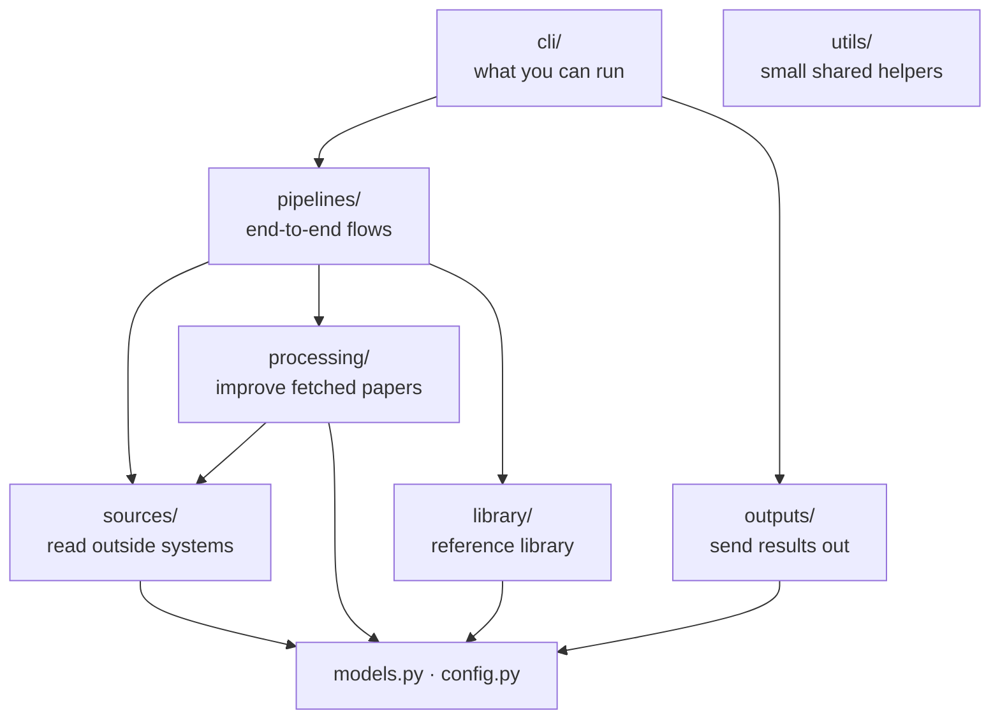

# Architecture

## Overview

LarkLab is a batch application around a small vector database. Commands are thin; the work happens in pipelines that call the folders below. Each folder holds one kind of thing, so a file's location tells you what it is.



Dependencies only point downward and there are no import cycles (checked by walking the import graph of all 50 modules: 124 internal imports). `utils/` is imported from everywhere and imports nothing from the project. `cli/` also calls `sources/` and `library/` directly for the single-paper library commands (`db-add`, `db-check`, …), which have no pipeline.

## Project structure

```
src/larklab/
├── main.py                      Entry point (delegates to cli/)
├── config.py                    Config: secrets and paths from .env (frozen; the token is hidden from repr)
├── models.py                    Paper, ScholarPaper, Recommendation, RecommendationResult, DailyDigest
│
├── cli/                         click commands — parse options, call a pipeline, print
│   ├── __init__.py              `cli` group, command registration, progress-log handler
│   ├── digest.py                digest
│   ├── recommend.py             recommend (also saves crawl progress after delivery)
│   └── library/                 one module per job
│       ├── add.py               db-add (+ duplicate prompts)
│       ├── edit.py              db-edit, db-delete
│       ├── browse.py            db-list, db-search
│       ├── health.py            db-check, db-rebuild
│       ├── backup.py            db-export, db-import
│       └── field_edits.py       overrides + title-clash error shared by add and edit
│
├── pipelines/                   orchestration; no printing, no click — reused by a future bot
│   ├── scholar_digest.py        DigestOptions, DigestResult, run_digest_pipeline
│   ├── paper_recommendations.py recommend_papers
│   ├── crawl_progress.py        load/advance the per-source resume points
│   └── outbox.py                recommendations Slack refused, kept for the next run
│
├── sources/                     reading from outside systems
│   ├── gmail/
│   │   ├── client.py            GmailClient: OAuth, list/fetch, parse (facade), trash
│   │   └── scholar_alert_parser.py  Scholar alert HTML → ScholarPaper (fragile, isolated)
│   └── papers/                  one module per source, same shape: fetch_by_*(…) -> Paper | None
│       ├── crossref_source.py   REST API (journal, or posting institution for preprints)
│       ├── arxiv_source.py      fetch by ID + crawl_recent (resumes after `since`)
│       ├── biorxiv_source.py    fetch by DOI + crawl_recent (retries timeouts)
│       ├── pubmed_source.py     E-utilities: fetch by DOI/title, crawl_recent (a US-Eastern day at a time)
│       ├── web_page_source.py   citation_* meta tags and site-specific abstract parsers
│       └── metadata_lookup.py   fetch_paper_metadata(doi, url): merges the sources
│
├── processing/                  improving the fetched papers
│   ├── abstract_enricher.py     email snippets → full abstracts
│   ├── dedup.py                 drop repeated titles, group by day
│   └── summarizer.py            three-bullet summaries (Ollama)
│
├── library/                     the reference library
│   ├── repository.py            PaperRepository: SQLite + sqlite-vec, transactional writes
│   ├── embedder.py              Ollama embeddings (batched)
│   └── similarity.py            find_similar_references(): top-3 references per paper
│
├── outputs/                     sending results somewhere
│   ├── slack/
│   │   ├── paper_thread.py      PaperCard, post_paper_thread, post_message (rate-limit retry)
│   │   ├── digest.py            send_digest_to_slack
│   │   └── recommendations.py   send_recommendations_to_slack
│   ├── terminal.py              console output and author formatting
│   └── digest_json.py           write_digest_json (--output-json, atomic)
│
└── utils/                       small helpers that know nothing about the project
    ├── identifiers.py           DOI / arXiv ID / URL helpers, DOI prefixes
    ├── text.py                  normalize_title, canonical_journal_name, collapse_whitespace
    ├── http.py                  build_http_client(): one shared httpx client
    └── files.py                 write_text_atomically

tests/                           mirrors src/larklab/ folder by folder; offline
scripts/manual/                  hand-run helpers that touch live Gmail / Slack
```

## Data flow

### `digest`

1. **sources** — `GmailClient` lists message IDs and reads their timestamps; `group_into_batches` splits them into alert batches (emails more than 2 hours apart are different batches). The requested number of newest batches is fetched in full and parsed into `ScholarPaper`s.
2. **processing** — `dedup_and_group_by_date` drops repeated titles (identical up to case and surrounding whitespace — the digest never merges two distinct papers) and groups by local received date.
3. **processing** — `enrich_abstracts` replaces each email snippet with a longer abstract: PubMed (DOI), PubMed (title), CrossRef, then the paper's web page. A fetched abstract is used only if longer than the snippet; a PubMed title hit's DOI is trusted only when its abstract was useful.
4. **processing** — optional `summarize_abstract` writes three bullets per paper with a local model.
5. **library** — `find_similar_references` embeds the papers and attaches the three closest references to each (scoring, not filtering; skipped with an empty library). Papers are sorted by top similarity so related papers are adjacent.
6. **outputs** — terminal, Slack (one thread per batch) and/or JSON. With `--cleanup`, after delivery every processed email is trashed except those with a paper in a digest that did not reach Slack (`message_ids_to_trash`); an email whose papers were all repeats goes too.

### `recommend`

`recommend_papers` crawls each source starting after that source's saved resume point, drops papers already in the library (DOI or normalized title), embeds the rest, scores them, applies the threshold and `--top-n`, and returns a `RecommendationResult`. The command merges in the recommendations Slack refused earlier, posts everything, saves whatever Slack refused again, and only then advances the resume points.

### `db-add`

`fetch_paper_metadata` → preview and missing-field warning → confirmation → embedding → `find_duplicates` (same title, or cosine similarity above 0.8) with a per-match `update` / `new` / `skip` prompt → `PaperRepository.add`.

## Key design decisions

### Folders are named for what they hold

`sources/` reads outside systems, `processing/` improves papers, `library/` is the reference library, `outputs/` sends results out, `utils/` holds helpers with no project knowledge, and each CLI command file is named after the job it does (`cli/library/health.py` is `db-check` and `db-rebuild`). Splitting is by job, never by line count.

### Pipelines are pure; commands are thin

`run_digest_pipeline(gmail, db_path, DigestOptions)` and `recommend_papers(repository, …)` take everything as arguments and return dataclasses. They never print, never read click options and never mutate a shared config. A future Slack bot can call them as they are. Progress is reported through `logging` (logger `larklab`); `cli/__init__.py` installs a stdout handler per invocation, so cron logs read as before.

### Recommendations resume, and nothing is lost on the way

arXiv's API lists a paper only after it is *announced* (Sunday to Thursday evening, US Eastern). At 09:00 in Korea the newest visible paper is one to three days old, so a fixed "yesterday" window was always empty — arXiv never showed up in Slack, weekday or weekend. Instead `pipelines/crawl_progress.py` keeps one entry per source in `data/crawl_progress.json` (the time of the newest paper handled), and each run asks only for papers newer than that mark (at most a week back), so a paper is recommended once and a skipped day is caught up. The sources are read at the same time (one thread each), so the slowest sets the duration.

Three rules keep papers from disappearing:

1. **A crawl reports whether it read everything** (`CrawlResult.complete`). If an arXiv category failed or the bioRxiv API kept timing out, that source's mark does not move and it is fetched again next time — a repeat is better than a gap.
2. **Undelivered recommendations are queued.** `send_recommendations_to_slack` returns the recommendations it could not post (a failed thread, or individual failed cards). `pipelines/outbox.py` stores them in `data/outbox.json`; the next run posts them together with the new ones, even when nothing new was found, and the file shrinks or disappears as Slack accepts them. Entries older than two weeks are dropped.
3. **Order of saving:** the outbox file is written first, then the progress mark, so a crash between them can only cause a repeat. This order lives in `run_recommendations` (`pipelines/paper_recommendations.py`), which the command and a future bot both call; it also drops waiting recommendations whose paper was added to the library since. The state file paths come from `Config`.
4. **Late announcements:** arXiv can list a paper after newer ones (one held for moderation). arXiv is therefore read two days further back than its mark, and `crawl_progress.json` keeps the DOIs of that stretch (`SourceProgress.seen`) so nothing is recommended twice. A paper held for longer than the overlap is still missed.

A `--no-slack` run is a dry run (`send=None`): it prints the outbox and the new recommendations and saves nothing. A missing or corrupt state file means "start fresh". bioRxiv publishes whole days, so it resumes at the day after the last one seen.

### Configuration separation

`Config` holds only what comes from the environment: OAuth paths, the Slack token (kept out of `repr`) and the DB path. Every behavioural setting is a click option, converted into a `DigestOptions` or passed as function arguments.

### One module per metadata source

Each file in `sources/papers/` talks to exactly one service and exposes `fetch_by_*` returning `Paper | None`. `metadata_lookup.py` is the only place that knows the priority order:

```
PubMed → arXiv → CrossRef → bioRxiv → (web page, only if still no title)
```

Each source fills only fields earlier sources left empty, and the lookup stops once title, authors, journal and abstract are all present. CrossRef precedes the bioRxiv API because it returns complete author lists (the bioRxiv API returned 45 of 61 authors for one paper) and names the posting server. The web page is last and only for a missing title, because a page's meta description is a poor substitute for an abstract. DOI prefixes live in `utils/identifiers.py` (`BIORXIV_DOI_PREFIXES` covers `10.1101/` and the 2026 prefix `10.64898/`).

### Transactional repository and atomic files

Every write in `PaperRepository` runs in one transaction. `replace_all` (import) and `replace_all_embeddings` (rebuild) swap the whole content at once, and callers compute embeddings first, so a failure half-way leaves the library unchanged. Files that other programs read (`--output-json`, `papers.md`, the progress file) are written to a temp file and renamed, so nobody sees a half-written file.

### Dataclasses over dicts

`ScholarPaper` (digest, DOI optional), `Paper` (library, DOI required to store, exact `published_at` with a derived `published_date`), `Recommendation` / `RecommendationResult` and `DailyDigest` give typed contracts between layers. `RecommendationResult` lives in `models.py` so `outputs/` can render it without depending on `pipelines/`.

### Parser isolation

Google Scholar's HTML will change eventually. All parsing is in `sources/gmail/scholar_alert_parser.py` and reached only through `GmailClient.parse_emails` — a format change is a single-file fix with `tests/sources/gmail/test_scholar_alert_parser.py` as the safety net.

### Synchronous execution

Gmail reads and trashing go out as batch requests of `BATCH_SIZE` (20) calls each, one HTTP round trip per batch: 100 emails are read in about 3 s instead of 37 s. A message that fails inside a batch is logged and skipped; it stays in the inbox and the next run picks it up. The summarizer runs with Ollama's thinking mode off, one request per paper, and gives up after three failures in a row.

## Extension points

### Completed

| Feature | Modules |
|---------|---------|
| Scholar digest to Slack, with AI summaries | `pipelines/scholar_digest.py`, `outputs/slack/digest.py`, `processing/summarizer.py` |
| Full abstracts | `processing/abstract_enricher.py`, `sources/papers/` |
| Email cleanup (trash after delivery) | `GmailClient.trash_messages` |
| Paper library with vector search | `library/repository.py`, `library/embedder.py` |
| Similarity scoring (top 3 references) | `library/similarity.py`, `pipelines/scholar_digest.py` |
| JSON export for scheduled agents | `outputs/digest_json.py` (`--output-json`) |
| Duplicate detection | `PaperRepository.find_duplicates`, `cli/library/add.py` |
| Multi-source metadata | `sources/papers/metadata_lookup.py` |
| Recommendations from arXiv / bioRxiv / PubMed, each paper once | `sources/papers/*_source.py`, `pipelines/paper_recommendations.py`, `pipelines/crawl_progress.py`, `outputs/slack/recommendations.py` — see [crawl-categories.md](crawl-categories.md) |

### Planned

- **Field classification**: auto-categorize papers by research area.
- **Full paper summarization**: PDF download and text extraction in `sources/`, full-text mode in `processing/summarizer.py`.
- **Slack bot**: `outputs/slack/bot.py` calling the pipelines for on-demand digests and queries.
- **Multi-backend summarization**: currently Ollama only (`ollama.chat()`); a provider flag in `processing/summarizer.py` would allow others.

### Adding a metadata source

1. Create `sources/papers/<name>_source.py` exposing `fetch_by_doi(client, doi) -> Paper | None` (return `None` rather than an empty `Paper` when the source does not know the paper).
2. Register it in `_build_lookups` in `sources/papers/metadata_lookup.py` at the right priority.
3. Test it with `httpx.MockTransport` (see `tests/sources/papers/test_crossref_source.py`).

## Known limitations

- **Abstract coverage**: papers not indexed in PubMed and hosted on JavaScript-rendered or bot-protected sites keep the short snippet from the email.
- **bioRxiv crawl only**: medRxiv is not crawled.
- **`papers.md` is lossy** (titles and DOIs). `db-import --md` re-fetches metadata over the network and may differ from the original; use `db-export` JSON or the `.db` file for faithful backups.
- **Two `recommend` runs must not overlap**: they share `crawl_progress.json` and `outbox.json` and there is no lock, so keep the cron times apart (a manual run during the hour-long PubMed run could overwrite the other's marks).
- **State files are per checkout**: if you run `recommend` from two checkouts, each keeps its own `data/crawl_progress.json` and `data/outbox.json`.
- **A source that keeps failing repeats**: if one arXiv category fails every day, the whole arXiv source is re-fetched every day (watch for `arXiv crawl stopped` in the log). Per-category marks would avoid this at the cost of more state.
